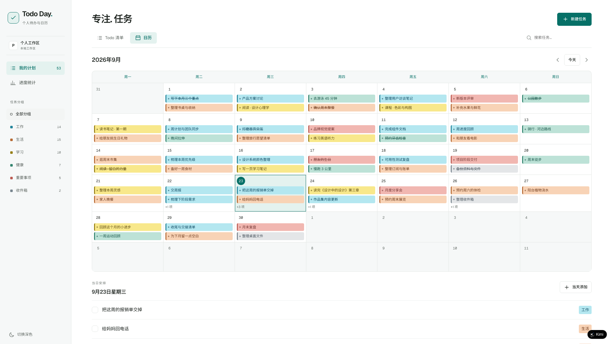

# 专注. 任务 · Todo Day

一个浅色默认、可选深色的个人任务规划应用：**Vue 3 前端 + Go 后端 + 嵌入式 SQLite**，单进程即可运行。默认进入日历，也提供 Todo 清单、番茄专注和进度统计，中英文功能一致。

## 功能总览

### 📅 日历（默认入口）

- 七列月历视图，任务按**分类色**标注：青蓝 / 浅黄 / 蜜桃 / 珊瑚 / 青绿 / 灰蓝，颜色与分组文字同时存在，不以颜色作为唯一提示
- 点击日期查看当天议程、当天直接添加任务；未排期任务在下方可编辑
- 小月历可作为日期筛选器，与清单**共享同一份数据**
- 移动端以「日期 + 任务数 + 分类色标」展示，具体内容在议程中

### ✅ Todo 清单

- 全部 / 今天 / 未完成 / 已完成 筛选，支持搜索、按分组过滤、四种排序（手动 / 日期 / 优先级 / 分组）
- 「今天」只含当天截止任务，逾期任务单独分组标红
- **快速添加**：一行字带出日期、分组、优先级——`明天 交周报 #工作 !!!`（`!!!` 高 / `!!` 中 / `!` 普通）
- 手动排序支持同分组内 pointer 拖拽与上下按钮，其他排序自动隐藏拖拽入口
- 完成 / 撤销完成、删除 / 撤销删除、清理已完成（同样可撤销）；只保留最近一批删除的撤销

### 🍅 番茄专注

- 主页列出**今天要处理的事**（今天截止 + 逾期未完成），选一件绑定，或不绑定直接开始；**今天的任务可直接在这一页勾选完成**，专注完不用切回清单
- 固定 **25 分钟倒计时**：开始 / 暂停 / 继续 / 放弃；走完铃响并记一个番茄；中途放弃不算番茄但专注时长仍计入（不足 1 分钟不记）
- **倒计时跨页面、跨刷新持续**：进行中的专注存在本地，刷新页面、切到别的模块、关掉标签页再回来都按最初定下的结束时刻继续；离开期间已走完的会自动补记一颗（归属时间仍是当初的结束时刻）
- 倒计时按结束时刻推算，后台标签节流不漂；标签页标题同步显示剩余时间，侧栏入口显示剩余分钟；铃响由模块触发，切到别的页面也听得到
- **今日番茄数、今日 / 本周 / 本月专注时长、近 4 周每日柱图、今天的专注记录**全部来自服务端 `focus_sessions`，按工作区时区归属到番茄结束那一天；记录失败时提示并可重试，不伪造已统计
- 任务标题在开始时快照，之后改名或删除不影响历史统计
- 「今天要处理的事」一键 **AI 四象限**：调用服务端技能把今日任务分到 重要且紧急 / 重要不紧急 / 紧急不重要 / 不紧急不重要 四格并附一句理由；任务数据由服务端组装、模型幻觉 id 会被丢弃，结果是一次性建议（不落库、不改任务）；未配置 AI 凭证或失败时如实提示，不编造分类。AI 技能由注册表驱动（`skills/` 目录，不写死代码，owner 可热加载），当前配额 60 次 / 工作区 / 日

### 📊 统计

- **18 周完成热力格**：一格一天，悬停显示当天完成数，颜色越深越多
- 本周完成 / 日均 / 最长连续天数，近 7 天完成柱图，按分组进度读数
- 全部 / 未完成 / 已完成 / **逾期**计数
- 热力、连续天数、近 7 天全部来自服务端同一份 `task_events` 聚合（按工作区时区），**无合成历史、无样本注入**
- CSV 导出、Canvas 海报、打印 / PDF 均由客户端本机生成，不自动外发

### ⚙️ 设置

- 在网页上配置**企业微信助手**（机器人 BotID / Secret）与 **AI 解析凭证**（Kimi API Key / 接口地址 / 模型），「测试连接」验证凭据后一键「启动/停止助手」——助手作为后端进程内的后台连接运行，无需另起进程
- 凭据由服务端加密保存，页面只显示「已配置 / 未配置」，**不回显已存密钥**；留空提交即保留原值
- 助手每次重连前自动取最新配置，改完**重连即生效**，不用重启；「测试/启动」做的是一次真实订阅（同一机器人只允许一条长连接，别同时手动跑独立 `assistant/` 进程）
- 仅工作区所有者可修改；需要服务端设置主密钥 `TODO_CONFIG_KEY`，否则只能保存非密钥项
- 凭据可随时**撤销**：勾选「清除已保存的密钥」并保存即删除，助手随之停止连接（已连接的会在一个心跳周期内断开），重新填写后自动恢复

### 🔐 账号与数据

- 注册即用，bcrypt 密码 + httpOnly 会话 Cookie（7 天滚动续期）
- 同一账号刷新、重新登录、换浏览器读到同一份数据；服务端按 workspace 成员关系授权，越权访问返回 403
- 编辑/完成走 version 乐观并发：冲突时前端采用服务端最新版本并提示，不丢数据
- 创建走 `client_id` 幂等键：双击、断网重试不会产生重复任务
- 旧版 localStorage 数据提供**用户确认后**的导入（预览数量、服务端去重、失败保留原值），绝不静默上传
- 浅色默认，一键切深色；键盘可操作（原生 dialog、快捷键、跳转链接）

## 更新日志

### 2026-10-20

**AI 技能体系 + 番茄专注四象限划分**

- 后端新增技能架构（`backend/internal/ai/`）：共享 LLM 传输（SSRF 加固）、技能注册表（`-skills` 目录加载 `skill.json` + `prompt.md`）、调用器（服务端组装上下文 → 调模型 → 校验输出）；接入适配器只做入口分发，不写死技能逻辑
- 首个技能 `skills/quadrant`：番茄专注页「今天要处理的事」一键四象限分类（IU/IN/NU/NN），附一句理由；未覆盖的任务单列「未分类」；结果是一次性建议，不落库、不改任务
- API：`POST /api/workspaces/{wid}/ai/invoke`（成员级）、`GET .../ai/skills`、`POST .../ai/skills/reload`（owner 热加载）；凭据沿用设置页的 Kimi 配置（fail-closed，撤销后不回落环境变量）；配额 60 次 / 工作区 / 日
- 未配置模型或调用失败时如实提示（409/429/502），绝不编造一份假分类

### 2026-10-16

**设置页：测试连接 + 一键启动/停止助手（后端内嵌运行）**

- 助手的连接与解析逻辑并入后端，作为进程内后台连接运行：设置页填好凭据后，「测试连接」做一次真实订阅验证，通过后再「启动助手」，无需登服务器跑进程
- 新增运行状态行（运行中 / 已停止 / 未配置）；后端重启后按开关自动恢复
- 「测试连接」与「启动助手」都会做一次真实订阅；若同时手动跑着独立 `assistant/` 进程（或另一个后端实例），同一机器人会被互相踢（单实例约束）
- 发件人授权沿用企业微信后台机器人的「可见范围」配置，不在本服务做用户绑定
- 助手解析改为只走 AI（Kimi）：一句话可以拆成多条任务，时间或重要程度不清楚时先追问（回复「取消」可作废），多轮规划失败退回单轮解析；未配置或解析失败时如实告知，不再有关键词规则兜底

### 2026-10-15

**新增设置页：在网页上配置企业微信助手与 AI 凭证**

- 侧栏新增「设置」入口，可填写机器人 BotID / Secret、Kimi API Key / 接口地址 / 模型，
  并一键启停助手——不再需要登服务器改 `.env`
- 凭据由服务端 **AES-256-GCM 加密**后落库，主密钥来自环境变量 `TODO_CONFIG_KEY`；
  未设置主密钥时拒绝保存密钥（绝不退化成明文），其余设置仍可保存
- 页面只显示「已配置 / 未配置」，**永不回显已存密钥**；留空提交表示保留原值
- 助手进程**每次重连前重新向后端取凭据**，网页上改完配置重连即生效，不用重启；
  后端未配置时自动回落到环境变量，现有 `.env` 部署不受影响
- 只有工作区所有者能修改配置与读取明文凭据；成员只能看到掩码
- 「**启用助手**」开关会被助手真正读取：停用期间不连接、每 3 秒检查一次配置，
  重新启用后几秒内自动恢复，不用重启进程。启用状态只由网页配置决定，
  环境变量里残留的凭据不会把它变回启用
- **凭据可撤销**：设置页新增「清除已保存的密钥」。撤销后助手停止连接
  （未连接时 ≤3 秒生效；已连接时由心跳复查后在 ≤30 秒内主动断开），
  重新填写后自动恢复。撤销是删除而非存储，缺主密钥时同样可用
- **安全收紧**：后端有配置行时，机密的与身份字段（BotID / Secret / Kimi Key）
  **不再回落环境变量**。原先的逐字段回落会让撤销失效——清空后端密钥后，
  环境变量里残留的旧凭据会把它悄悄顶回来
- 顺带修复：CSRF 中间件原先只校验 POST/PATCH/DELETE，漏了 PUT，
  改为「非 GET/HEAD/OPTIONS 一律校验」

**企业微信助手改用智能机器人长连接**

- 接入方式从「自建应用接收消息回调」换成**智能机器人 + WebSocket 长连接**：
  不再需要公网 HTTPS、反向代理与加解密，消息是明文 JSON
- 旧的 `internal/wecom`（XML 回调 + AES + CorpID 校验）整个删除，
  新增 `internal/aibot`（订阅、30 秒心跳、断线退避重连、帧解析、回复）
- 配置从五件套（CorpID/AgentID/Secret/Token/AESKey）换成 BotID + Secret
- 引入 `github.com/gorilla/websocket`：模块不再是「仅标准库」
- 回复改为绑定回调的 `req_id`（长连接回复的是「某次回调」而不是「某个人」）
- 实测：真实连上 `wss://openws.work.weixin.qq.com`，用假凭据返回
  `errcode 853000 invalid bot_id or secret` —— 说明握手、帧结构与订阅命令
  均正确（服务端看懂了我们发的内容才可能具体地拒绝凭据）

**新增企业微信 AI 助手**

- 新目录 `assistant/`：在企业微信里说一句计划，助手把它记进任务列表
- 走自建应用的「接收消息」回调（群机器人只能往外推，收不到消息）
- Kimi 做自然语言解析，未配置密钥或调用失败时自动退回规则解析，服务照常可用
- 走 HTTP 调用现有后端，复用服务端的字段校验、工作区授权与幂等；不直连数据库
- 回执异步推送：回调只做解密并立刻响应，避开企业微信 5 秒超时重投
- 不含部署与内网穿透，详见 [assistant/README.md](assistant/README.md)

**修复：完成/编辑任务后热力图不刷新**

- 统计接口带缓存标记，完成或编辑任务后调用刷新时没有强制取新数据，
  导致热力图、时间统计一直停留在打开统计页那一刻的旧结果
- 现在完成、编辑任务后强制刷新，进入统计页也强制拉取当前数据

**番茄专注：每日专注改为折线图**

- 「近 4 周每日专注」由柱状图换成折线图，带面积填充与今日高亮圆点
- 移除图表下方关于统计来源的说明小字
- 折线图等比缩放，缩放后线宽与圆点保持不变形

**番茄专注：倒计时持续 + 任务可勾选完成**

- 进行中的倒计时写入本地存储（含工作区、绑定任务、结束时刻）：刷新页面、切换模块、关掉标签页再回来都按原结束时刻继续，暂停状态同样恢复
- 恢复时若倒计时早已走完，自动补记一颗番茄，归属当初的结束时刻；离开期间不静默丢记录，也不重复记录
- 铃响与标题倒计时移出页面组件，切到别的模块（页面已卸载）依然会响；标签页标题在任意页面显示剩余时间
- 今日任务行拆成「勾选完成」+「选择专注」两个独立控件，专注完顺手标记完成

**番茄专注模块上线**

- 主页展示今天要处理的事（当天截止 + 逾期未完成），选一件绑定或自由开始
- 固定 25 分钟倒计时：开始 / 暂停 / 继续 / 放弃；走完记一个番茄，中途放弃只计时长（不足 1 分钟不记）
- 今日番茄数、今日 / 本周 / 本月专注时长、近 4 周每日柱图、今日记录，全部读自服务端记录并归属到番茄结束当天
- 侧栏「我的计划」下方新增入口

**README 文档**

- 新增项目说明：功能介绍、关键页面、技术结构、快速开始与测试指引

**全栈改造：Vue 3 前端 + Go 后端**

- 前端由 React 重写为 Vue 3 + Vite + TypeScript，页面视觉与交互保持不变
- 后端新增 Go 服务：嵌入式 SQLite（WAL）、bcrypt 密码与会话 Cookie、任务 REST 接口、按工作区的服务端授权
- 任务持久化到服务端：幂等创建、version 乐观并发（冲突以服务端版本覆盖并提示）、原子排序、软删除与服务端恢复
- 统计与热力改为读服务端完成事件，移除样本注入与合成历史；旧浏览器数据改为用户确认后导入

### 2026-10-14

**项目初始化**

- 初始化「专注. 任务 · Todo Day」模板
- 复刻同款界面：日历默认入口、Todo 清单、进度统计、浅色默认与可选深色、中英文对应功能

## 许可说明

Geist / Geist Mono / Noto Sans SC 均本地托管（SIL OFL 1.1，许可证见 `frontend/public/fonts/`），不依赖外部字体请求。无图库品牌图片或商业字体。
